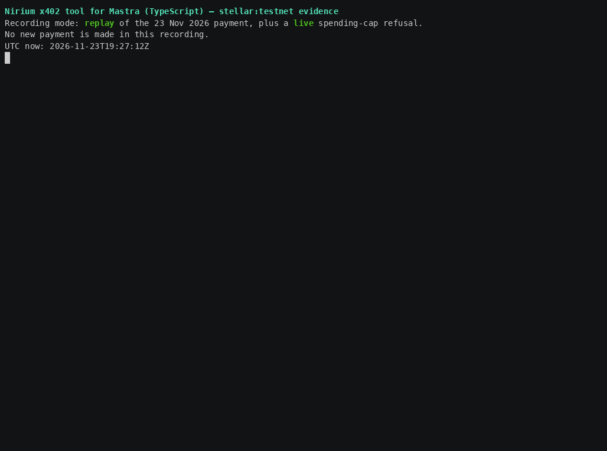

# Mastra x402 tool (TypeScript)

A [Mastra](https://mastra.ai) tool that pays x402 endpoints through the Nirium
TypeScript SDK. It wraps `x402Fetch()` with a per-payment cap: when a server asks
for more than the cap, the SDK refuses before signing, and the tool returns that
refusal as a normal tool result so the agent can report it and stop instead of
crashing.

Testnet only. The seller is one you run, with your own `payTo`; no Nirium address
is involved and no key is ever sent anywhere.

## Demo



A 25-second screen recording. It shows the seller's live `402` challenge,
verifies the 23 Nov 2026 payment on Horizon and Stellar Expert, replays the
captured paid output (clearly labelled: it is not a new payment), and calls
`/premium/report` live to show the `$0.05` cap refusing `$2.00` before signing.
No payment is made in the recording.

## Files

| Path | What it is |
|---|---|
| `src/nirium-payer.ts` | `createNiriumPayer()`: builds an SDK `Agent` and calls `initX402({ maxAmountPerPayment })`. The cap lives here. |
| `src/nirium-tool.ts` | `createNiriumPayTool()`: the Mastra `createTool` wrapper around `payer.x402Fetch()`. |
| `src/agent.ts` | A Mastra `Agent` with the tool, and the instructions that tell it never to raise the cap. |
| `src/demo.ts` | Calls the tool twice with no LLM: one call under the cap, one over it. |
| `src/refused.ts` | Calls only the over-cap route, so the refusal can be shown without paying. |
| `server/server.ts` | The seller: `x402Serve()` on Express with your own `payTo` and two routes, $0.02 and $2.00. |
| `test/nirium-tool.test.ts` | Offline tests. No network. |

## Versions tested

Pinned in `package.json`. Tested on Node.js 24.22.2 (the SDK requires >= 22.12).

| Package | Version |
|---|---|
| `@mastra/core` | 1.85.0 |
| `nirium` | 0.19.8 (`file:../../packages/sdk`) |
| `@stellar/stellar-sdk` | 16.3.0 |
| `@x402/core`, `@x402/express`, `@x402/stellar`, `@x402/extensions` | 2.28.0 |
| `zod` | 4.6.7 |
| `express` | 5.2.1 |
| `tsx` | 4.21.0 |
| `typescript` | 5.9.3 |

## Setup

```bash
# The example links the SDK from this checkout, so build it once.
cd ../../packages/sdk && npm install --legacy-peer-deps && npm run build && cd -

npm install --legacy-peer-deps
cp .env.example .env
```

Fill `.env` with **your own** `stellar:testnet` key (`STELLAR_SECRET_KEY`, funded
by [Friendbot](https://friendbot.stellar.org) and holding testnet USDC), your own
receiving address (`NIRIUM_X402_PAY_TO`), and a free testnet facilitator key from
[channels.openzeppelin.com/testnet/gen](https://channels.openzeppelin.com/testnet/gen)
(`NIRIUM_X402_FACILITATOR_API_KEY`). Never commit `.env`.

## Run

```bash
npm run server   # the seller, on http://127.0.0.1:3404
npm start        # the tool, twice: the $0.02 call pays, the $2.00 call is refused
npm run refused  # only the $2.00 route: the cap refuses it, nothing is paid
npm run agent    # the same tool driven by a Mastra agent (needs MASTRA_MODEL + provider key)
```

`npm start` needs no LLM. It prints two results.

### The paid call

`GET /premium/signals` asks $0.02 and the cap is $0.05, so the SDK signs and the
facilitator settles. This is the real output of the run recorded in
[Evidence](#evidence) on 23 Nov 2026:

```json
{
  "ok": true,
  "paid": true,
  "refused": false,
  "status": 200,
  "url": "http://127.0.0.1:3404/premium/signals",
  "data": {
    "ok": true,
    "route": "/premium/signals",
    "price": "0.02 USDC",
    "signals": [{ "pair": "XLM/USDC", "confidence": 0.71, "note": "example payload, not financial advice" }]
  },
  "transaction": "875ebdd2fb87b49bf76a1a6b6540a3a897dc2e894fe15c6a0bcd6f1e493b5322"
}
```

The `transaction` value is read from the server's `PAYMENT-RESPONSE` header, so it
is the hash that settled on testnet. Open it at
`https://stellar.expert/explorer/testnet/tx/<hash>`.

### The refused call

`GET /premium/report` asks $2.00 against the same $0.05 cap. This is the real
output, from a local x402 challenge (the SDK and `@x402/core` run unmodified):

```json
{
  "ok": false,
  "paid": false,
  "refused": true,
  "status": 402,
  "url": "http://127.0.0.1:3404/premium/report",
  "refusal": {
    "code": "X402_SPEND_CAP_EXCEEDED",
    "reason": "x402Fetch refused to pay http://127.0.0.1:3404/premium/report: the server asked for 2 USDC (20000000 atomic units) and the per-payment cap is $0.05. The signer was not called; nothing was signed or sent. The cap is enforced by @x402/core; raise it explicitly with initX402({ maxAmountPerPayment }).",
    "amount": "20000000",
    "formattedAmount": "2 USDC",
    "cap": "$0.05"
  }
}
```

Nothing was signed and no transaction exists for it. The agent sees a normal tool
result and reports the amount and the cap; the run continues.

## Use it in an agent

```typescript
import { Agent } from '@mastra/core/agent';
import { createNiriumPayer } from './src/nirium-payer.ts';
import { createNiriumPayTool } from './src/nirium-tool.ts';

const payer = createNiriumPayer({
    secretKey: process.env.STELLAR_SECRET_KEY,
    network: 'stellar:testnet',
    maxAmountPerPayment: '$0.05',   // required; no unbounded mode
});
const payTool = createNiriumPayTool({ payer });

export const agent = new Agent({
    id: 'nirium-payer',
    name: 'Nirium payer',
    instructions: 'Buy data with pay_x402_endpoint. Never ask for a higher cap. '
        + 'If a payment is refused, report the amount and the cap, then stop.',
    model: 'openai/gpt-5-mini',
    tools: { payTool },
});
```

The cap is enforced by `@x402/core` while it selects payment requirements, which
happens before the Stellar auth entry is built. `X402SpendCapError` carries
`amount`, `formattedAmount`, `cap` and `signerCalled: false`; the tool maps it to
`refused: true` and rethrows every other error.

## Tests

```bash
npm test          # node:test via tsx, no network
npm run typecheck
```

Five tests, no external network:

1. **Over the cap.** A real `node:http` seller answers a real x402 v2 challenge for
   2 USDC. The real SDK, `@x402/core` and `@x402/fetch` run unmodified. The tool
   returns `refused: true` with the amount and the cap, the signer is never
   called, and the seller sees exactly one request with no `PAYMENT-SIGNATURE`.
2. **Under the cap.** The same challenge for 0.01 USDC does not trigger the cap:
   the payment proceeds past selection and fails later, at the (deliberately
   unreachable) RPC. The error is not `X402_SPEND_CAP_EXCEEDED`.
3. **Paid mapping.** A stub transport returns 200 with a `PAYMENT-RESPONSE`
   header; the tool returns the body and the transaction hash. A real settlement
   needs a facilitator and a funded account, so this one does not go on-chain.
4. **Other failures** are rethrown, not swallowed.
5. **The cap is required** and validated before any payment.

## Evidence

Run on `stellar:testnet` on 23 Nov 2026, against the seller in `server/`
started with `npm run server`. The payer and the seller are two fresh keys
generated for this run; the seller is my own address, not a Nirium one, and no
secret is in this repository.

| Account | Address |
|---|---|
| Payer (`STELLAR_SECRET_KEY`) | [`GCGCQ23W66VGCQL4Q3M5SNGRPUGGFZLHSDPH33PVGKPXO2I22CKDROSX`](https://stellar.expert/explorer/testnet/account/GCGCQ23W66VGCQL4Q3M5SNGRPUGGFZLHSDPH33PVGKPXO2I22CKDROSX) |
| Seller (`NIRIUM_X402_PAY_TO`) | [`GBVIKQCV5ZGEQ55X4WZOVFJZ6HJ2WWLNLQVSSEIJO43CPJ4W3AKJ5VGY`](https://stellar.expert/explorer/testnet/account/GBVIKQCV5ZGEQ55X4WZOVFJZ6HJ2WWLNLQVSSEIJO43CPJ4W3AKJ5VGY) |

| Step | Transaction |
|---|---|
| Friendbot funding, payer | [`d099618ea0772636ed808ad4c7aaa6be33fab98f6ab9f1c81d458861e3fcb5a3`](https://stellar.expert/explorer/testnet/tx/d099618ea0772636ed808ad4c7aaa6be33fab98f6ab9f1c81d458861e3fcb5a3) |
| USDC trustline, payer | [`1860cf880f13ad1e5f13bb99d29465900407bf17db71bca1926030c512f04e8d`](https://stellar.expert/explorer/testnet/tx/1860cf880f13ad1e5f13bb99d29465900407bf17db71bca1926030c512f04e8d) |
| Friendbot funding, seller | [`3bf83df30d5c122021ccd819dc057a59cc206f0967490439bd36fd27971c9f6a`](https://stellar.expert/explorer/testnet/tx/3bf83df30d5c122021ccd819dc057a59cc206f0967490439bd36fd27971c9f6a) |
| USDC trustline, seller | [`e3b537b0f015be8293c2b32cf9a4806482f9bba3f222050b6a794184aa740605`](https://stellar.expert/explorer/testnet/tx/e3b537b0f015be8293c2b32cf9a4806482f9bba3f222050b6a794184aa740605) |
| Payer acquires testnet USDC (5 XLM → 3.2924896 USDC, DEX path payment) | [`02c50248c81e7b3177f0369406ecf21d9d1996c510b2d3792ac63d1262702bbd`](https://stellar.expert/explorer/testnet/tx/02c50248c81e7b3177f0369406ecf21d9d1996c510b2d3792ac63d1262702bbd) |
| **`GET /premium/signals` — 0.02 USDC paid** | [`875ebdd2fb87b49bf76a1a6b6540a3a897dc2e894fe15c6a0bcd6f1e493b5322`](https://stellar.expert/explorer/testnet/tx/875ebdd2fb87b49bf76a1a6b6540a3a897dc2e894fe15c6a0bcd6f1e493b5322) |
| `GET /premium/report` — 2.00 USDC, refused | None. Refused before signing; no transaction exists. |

**The paid call.** Horizon reports `successful: true` for the payment, in ledger
`5887415` at `2026-11-23T19:05:17Z`. Its effects are `account_debited`
`0.0200000 USDC` on the payer and `account_credited` `0.0200000 USDC` on the
seller. The fee was sponsored by the facilitator (fee account
`GA6THKUY2XJZOBRFMEQMMEADSCQLCZ2QMQWAWMMDXBTE7SARKAXVH7TL`), so the payer spent
no XLM on the payment. Balances after the run: payer `3.2724896 USDC`, seller
`0.0200000 USDC` — exactly one payment, matching the price to the last digit.

**The refused call.** The same run printed this, with no `transaction` field:

```json
{
  "ok": false,
  "paid": false,
  "refused": true,
  "status": 402,
  "url": "http://127.0.0.1:3404/premium/report",
  "refusal": {
    "code": "X402_SPEND_CAP_EXCEEDED",
    "reason": "x402Fetch refused to pay http://127.0.0.1:3404/premium/report: the server asked for 2 USDC (20000000 atomic units) and the per-payment cap is $0.05. The signer was not called; nothing was signed or sent. The cap is enforced by @x402/core; raise it explicitly with initX402({ maxAmountPerPayment }).",
    "amount": "20000000",
    "formattedAmount": "2 USDC",
    "cap": "$0.05"
  }
}
```

The seller received no second payment: its only incoming transfer is the 0.02
USDC above.

**What was actually run.** The paid and refused calls above were made by calling
the Mastra tool directly from `src/demo.ts`, not through an LLM: no model-provider
key was configured for this run, so `src/agent.ts` was not exercised with a live
model. It is the same tool the agent is given, and the agent wiring is in
`src/agent.ts`; an LLM-driven run is left to whoever has a provider key.

**Getting testnet USDC.** Circle's faucet gates testnet USDC behind a reCAPTCHA.
If you cannot use it, a path payment on the Stellar testnet DEX works: the payer
in this run swapped 5 XLM for 3.2924896 USDC (the row above). The asset is
`USDC:GBBD47IF6LWK7P7MDEVSCWR7DPUWV3NY3DTQEVFL4NAT4AQH3ZLLFLA5`, whose SAC is
`CBIELTK6YBZJU5UP2WWQEUCYKLPU6AUNZ2BQ4WWFEIE3USCIHMXQDAMA` — the same contract the
402 challenge names.

## What this does not solve

- **The cap is a buyer-side check.** It stops `x402Fetch` from signing an
  over-cap payment. Any code in the same process that holds the raw key (or
  replaces the signer) can sign without asking it. Nothing on-chain enforces it.
- **No spend total.** This is a per-payment cap, not a daily or per-task budget.
  For that, see [`../x402-policy-daily-budget`](../x402-policy-daily-budget).
- **Untrusted content reaches the model.** The paid body is returned to the agent
  as data. Treat it as untrusted input: it can contain instructions.
- **No idempotency or reconciliation.** If the payment settles and the response is
  lost, the tool reports the failure and there is no retry that reuses the same
  payment.
- **The seller is yours.** `x402Serve()` runs on your machine, the facilitator
  verifies and settles, and Nirium is not in the path.
