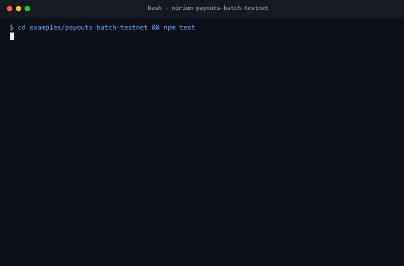

# Nirium Payouts on Testnet: Batch Payout Run Signed Client-Side

A runnable, non-custodial example demonstrating a batch payout run for **10 testnet recipients** using the Nirium TypeScript SDK and `@stellar/stellar-sdk`.

The Nirium Agent builds an unsigned transaction XDR containing all batch payments; the transaction is signed **strictly client-side** using the payer's local Stellar keypair and broadcast to Stellar testnet.

---

## Demo Walkthrough



---

## Security Guarantee: Client-Side Signing

> [!IMPORTANT]
> **The payer's secret key never leaves this machine and is never transmitted or logged.**
> - Nirium's Agent API is strictly an unsigned XDR generator and broadcaster.
> - Transaction signing occurs entirely within your local Node.js process via `@stellar/stellar-sdk`.
> - The secret key is excluded from logs, error messages, and HTTP payloads.

---

## Architecture Flow

```
[Local Node Process]                      [Nirium Agent Node]               [Stellar Testnet]
        |                                          |                                |
        |--- 1. createPayoutRun(10 recipients) --->|                                |
        |                                          | (Builds Batch Payment XDR)     |
        |<-- 2. Returns Unsigned XDR + runId ------|                                |
        |                                                                           |
        | [Sign Locally with STELLAR_SECRET_KEY]                                    |
        |                                                                           |
        |--- 3. submitPayout(runId, signedXdr) --->|                                |
        |                                          |--- 4. Broadcast to Horizon --->|
        |                                          |<-- 5. Returns txHash & CID ----|
        |<-- 6. Returns PayoutRun confirmation ----|
```

---

## Handled Edge Cases: Trustline Onboarding

Recipients lacking a trustline for the payout asset (e.g. USDC) cannot receive payments directly. Instead of failing silently, this example detects untrusted recipients and demonstrates onboarding:

1. **Detection:** When `run.untrustedRecipients` contains accounts, the script reports each untrusted address.
2. **Onboarding Build:** Calls `agent.onboardPayoutRecipient(address, { asset: 'USDC' })` to generate a self-signed trustline establishment XDR.
3. **Broadcast:** Broadcasts the signed trustline transaction via `agent.submitPayoutOnboard(signedXdr)` prior to running the payout.

---

## Testnet Verification: 10 Confirmed Recipients

Transaction hash confirmed on Stellar Expert (Testnet):
- **Transaction Hash:** [`323525d2b4f539824c0564468c2820e959ab1e0159aeaded75fb31c0583d1615`](https://stellar.expert/explorer/testnet/tx/323525d2b4f539824c0564468c2820e959ab1e0159aeaded75fb31c0583d1615)
- **Run ID:** `pay_1795049888754_c6efw`
- **Total Amount Disbursed:** `1.0000000 USDC` across 10 operations in 1 atomic transaction

### Recipient Accounts Verified on Stellar Expert

Each recipient was funded via Stellar Friendbot and onboarded with a self-signed USDC trustline (`GBBD47IF6LWK7P7MDEVSCWR7DPUWV3NY3DTQEVFL4NAT4AQH3ZLLFLA5`):

| S.No. | Recipient Public Key | Amount | Stellar Expert Explorer Link |
|:-----:|:---------------------|:------:|:-----------------------------|
| 1 | `GAP6R5XPNHSUIIIJGXRGRRKTJT4YPXQQIUWRQ37PXDGSAJVMRDNBCNZG` | 0.10 USDC | [View Account](https://stellar.expert/explorer/testnet/account/GAP6R5XPNHSUIIIJGXRGRRKTJT4YPXQQIUWRQ37PXDGSAJVMRDNBCNZG) |
| 2 | `GD5GYULPOANDMTMIMZ3SNPJAWMAGF4XM5MJ3ZLFL3FSDXSPHHXD3VJFC` | 0.10 USDC | [View Account](https://stellar.expert/explorer/testnet/account/GD5GYULPOANDMTMIMZ3SNPJAWMAGF4XM5MJ3ZLFL3FSDXSPHHXD3VJFC) |
| 3 | `GDAOS5AJTSP5SKLOU3VFYEMUQ4VVFSON7OCBLMLW7C2XX3LD3ON7O6WR` | 0.10 USDC | [View Account](https://stellar.expert/explorer/testnet/account/GDAOS5AJTSP5SKLOU3VFYEMUQ4VVFSON7OCBLMLW7C2XX3LD3ON7O6WR) |
| 4 | `GA5ZEMWGPVMXC6CI6Z2VPWOKYNEWLP3R7FR5TCAAWWICPWMKZHECAWKT` | 0.10 USDC | [View Account](https://stellar.expert/explorer/testnet/account/GA5ZEMWGPVMXC6CI6Z2VPWOKYNEWLP3R7FR5TCAAWWICPWMKZHECAWKT) |
| 5 | `GAKAGOHBRPFUEYG5FAG5XOE3TRDCVR6MARKEM6B6GTNPOE4FCBNSIKSK` | 0.10 USDC | [View Account](https://stellar.expert/explorer/testnet/account/GAKAGOHBRPFUEYG5FAG5XOE3TRDCVR6MARKEM6B6GTNPOE4FCBNSIKSK) |
| 6 | `GCHPQPONZPPFC4YOGCJCQ4FMBOZKH3XUNLTWDAB7IUXLQXT3LFNPGMJI` | 0.10 USDC | [View Account](https://stellar.expert/explorer/testnet/account/GCHPQPONZPPFC4YOGCJCQ4FMBOZKH3XUNLTWDAB7IUXLQXT3LFNPGMJI) |
| 7 | `GBVZ4BUKBH2ZEX7N2QLOIMYPXFXX2VLJGGPQWB5RJPRIS2ORKJYGKE4K` | 0.10 USDC | [View Account](https://stellar.expert/explorer/testnet/account/GBVZ4BUKBH2ZEX7N2QLOIMYPXFXX2VLJGGPQWB5RJPRIS2ORKJYGKE4K) |
| 8 | `GCXWKNTEFN4BZQZLKZHSA5M3NYFSOVSV6DS7GKRWRY22QED3L4WGUU23` | 0.10 USDC | [View Account](https://stellar.expert/explorer/testnet/account/GCXWKNTEFN4BZQZLKZHSA5M3NYFSOVSV6DS7GKRWRY22QED3L4WGUU23) |
| 9 | `GAGRAVGV4X2HBHJXFQLSWA4BIYLHI7ILVBBM2OSCMM6YY7ECII2W2EGS` | 0.10 USDC | [View Account](https://stellar.expert/explorer/testnet/account/GAGRAVGV4X2HBHJXFQLSWA4BIYLHI7ILVBBM2OSCMM6YY7ECII2W2EGS) |
| 10 | `GCLLANEY66BZQXSWS54OOB372R7THAP47ELM2OZL2GI75L6JMUDCWIGO` | 0.10 USDC | [View Account](https://stellar.expert/explorer/testnet/account/GCLLANEY66BZQXSWS54OOB372R7THAP47ELM2OZL2GI75L6JMUDCWIGO) |

---

## Running the Quickstart

### 1. Install Dependencies

```bash
npm install
```

### 2. Configure Environment

Copy `.env.example` to `.env`:

```bash
cp .env.example .env
```

Set your testnet payer secret key:
```env
STELLAR_SECRET_KEY=S...
NIRIUM_BASE_URL=https://nirium-agent.fly.dev
```

Fund your testnet payer account via Stellar Friendbot if not already funded:
```bash
curl "https://friendbot.stellar.org?addr=<YOUR_PAYER_PUBLIC_KEY>"
```

### 3. Run the Example

```bash
npm start
```

---

## Offline Unit Tests (Zero Network)

The test suite tests run-building, offline local signing, untrusted recipient reporting, error explanation, and full API interaction using a mocked HTTP layer:

```bash
npm test
```

Expected output:
```
✔ buildBatchPayoutOptions builds valid batch payload for 10 recipients
✔ buildBatchPayoutOptions rejects empty recipient list
✔ resolveTestnetPassphrase accepts testnet passphrase
✔ resolveTestnetPassphrase rejects public/mainnet passphrase for testnet safety
✔ signUnsignedXdr signs transaction locally with caller key
✔ signUnsignedXdr validates secret key format
✔ publicKeyFromSecret derives valid G-address
✔ reportUntrustedRecipients outputs onboarding guidance for untrusted wallets
✔ reportUntrustedRecipients handles clean recipient list
✔ explainFailure correctly identifies missing trustlines
✔ explainFailure correctly identifies underfunded payer account
✔ stellarExpert URLs format valid links
✔ Agent payout workflow executes end-to-end with mocked HTTP layer (zero network)

ℹ tests 13
ℹ pass 13
ℹ fail 0
```
